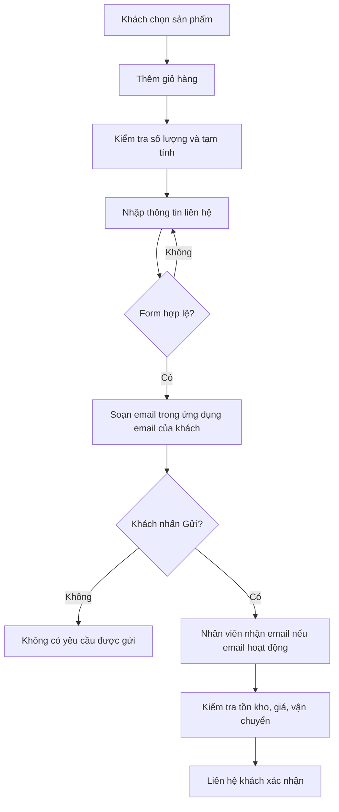
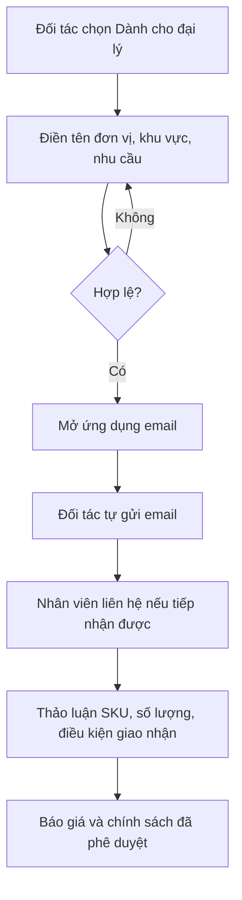
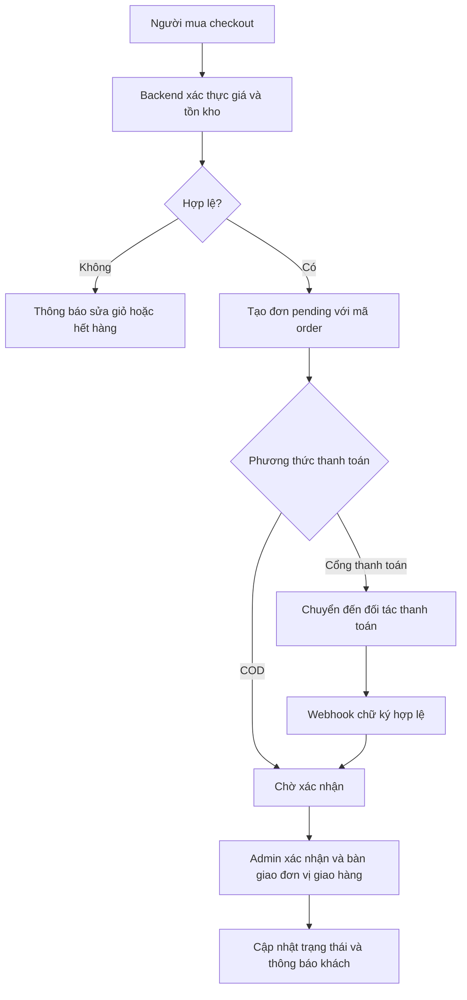

# BPMN – workflow tóm tắt (phục vụ duyệt nghiệp vụ)

> Đây là **sơ đồ mô tả luồng** bằng Mermaid, không phải file BPMN 2.0 executable. Cần được vẽ lane/participant trong Camunda Modeler sau khi doanh nghiệp xác nhận.

## 1. Khách hàng gửi yêu cầu đặt hàng – website demo

## 2. B2B – tiếp nhận báo giá đại lý

## 3. Flow mục tiêu khi có backend production

